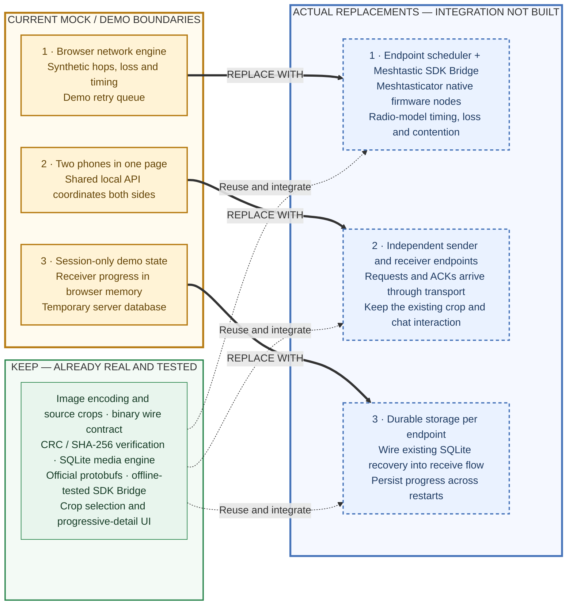
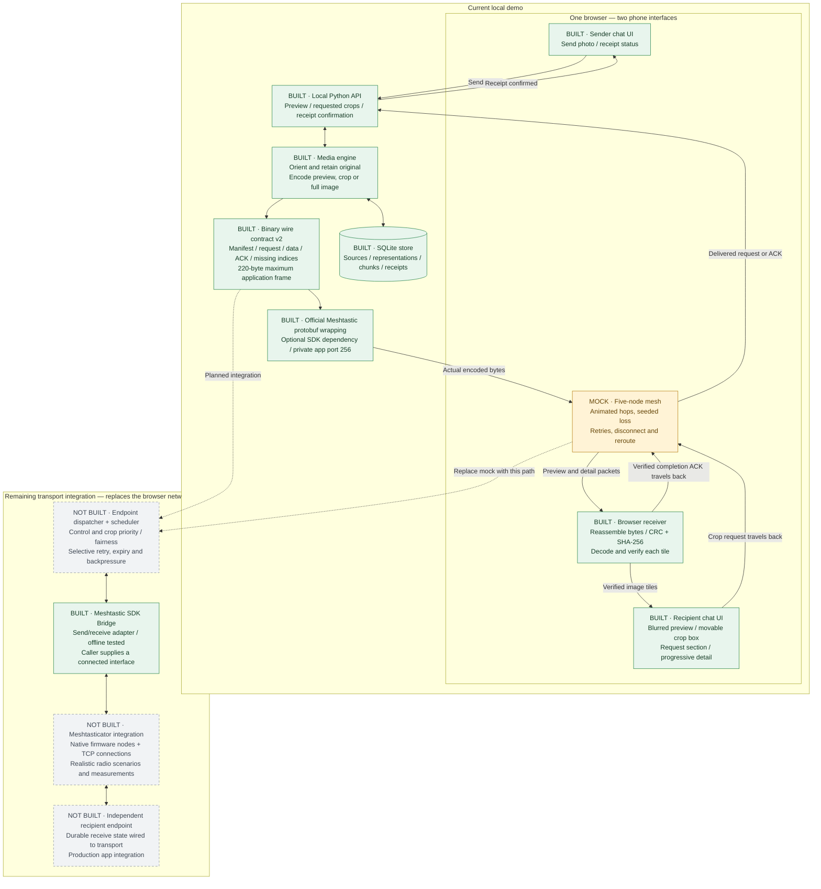

# Project architecture and implementation status

Status reflects the code currently in this repository. **Built** means implemented
and locally tested; it does not imply deployment or physical-radio validation.

## Architecture

### Mock boundaries and their replacements

Each amber box is a demo boundary to replace. Each blue box names its intended
replacement; these integrations are **not built yet**. Green components are real
implementation to retain and connect to the new transport.

The center map can stay as a visualization: its packet events will come from the
integrated simulator instead of the browser's synthetic network engine.
Meshtasticator is the next software target. Physical LoRa accessories connected
over BLE/serial are a later transport option, outside the initial scope.
The SDK Bridge and SQLite recovery code already exist; their end-to-end wiring
is the missing work, rather than rebuilding those components.

### Current data flow and planned transport

Green = **built** · Amber = **working mock** · Gray/dashed = **not built**.
The two phone interfaces currently share one browser session and one local server.

The demo wraps frames using the official protobufs when the optional Meshtastic
dependency is installed. It does **not** send them through the SDK Bridge or a
radio. The bridge is a separate, offline-tested integration boundary.

## What is finished, partial, and outstanding

| Area | Status | What we have / what remains |
| --- | --- | --- |
| Phase 1: media handling | **Built** | Original retention, EXIF orientation, JPEG/WebP encoding, preview/crop/full-image representations, binary packets, integrity checks, cache reuse and restart-safe Python reconstruction. |
| Two-phone interaction | **Built as a local UI** | Send a preview, drag/resize a crop, request that section, progressively reveal six independently verified source tiles, and confirm receipt after the ACK returns. |
| Network visualization | **Working mock** | Five nodes, per-hop seeded loss, bounded end-to-end retries, relay removal, alternate routes, pause and disconnection. Animation time is illustrative. |
| Meshtastic reuse | **Adapter built; integration pending** | Official SDK/protobufs and a send/receive bridge are tested offline. Connected endpoints, firmware nodes and transport dispatch are not wired together. |
| Phase 2: transport and radio model | **Not built** | Production queueing, packet-boundary priority, fairness, backpressure, retry/expiry policy, radio range/presets, airtime, contention, duty-cycle behavior and erasure-correction evaluation. |
| Phase 3: production application | **Partial** | The interaction is implemented in the browser mock. Separate device sessions, durable browser receive state, photo-import UI and the full-image request UI remain unfinished. The media engine already supports full-image representations. |
| Performance and acceptance evidence | **Partial** | Codec/packet measurements and automated local checks exist. Firmware-backed five-node acceptance, airtime accounting, request round-trip measurements and crop-versus-full-image benchmarks remain outstanding. |
| Physical radios / native mobile apps | **Outside initial scope** | No physical LoRa/BLE field validation or native iOS/Android app has been built. |

## How a section becomes sharp today

1. The sender retains the original; the server encodes a tiny preview.
2. Actual preview packets cross the browser's mock mesh. The browser reconstructs
   and verifies them before displaying the preview.
3. The recipient selects a box and clicks **Request section**. The request crosses
   the reverse mock route before the server creates detail.
4. The server crops the original into six independently encoded tiles. Their
   actual packets cross the mock mesh, and each verified tile appears in place.
5. Completion ACKs travel back. The sender shows confirmed receipt only after
   the server receives and validates those ACKs.

The server's demo database is temporary and removed on shutdown. Python media
storage supports restart recovery with a retained database, but browser receive
progress currently lives in memory and does not survive a page reload.

## Code map

| Component | Implementation |
| --- | --- |
| Phone UI and interaction | [app.mjs](../imageoverbt/ui/app.mjs), [index.html](../imageoverbt/ui/index.html), [style.css](../imageoverbt/ui/style.css) |
| Mock network | [network.mjs](../imageoverbt/ui/network.mjs) |
| Browser packet receiver | [protocol.mjs](../imageoverbt/ui/protocol.mjs) |
| Local API | [ui_server.py](../imageoverbt/ui_server.py) |
| Image processing and SQLite state | [media.py](../imageoverbt/media.py) |
| Binary frame contract | [contract.py](../imageoverbt/contract.py) |
| Official SDK adapter | [meshtastic_transport.py](../imageoverbt/meshtastic_transport.py) |
| Local event vocabulary | [events.py](../imageoverbt/events.py) — full transport metrics integration remains pending |
| Automated checks | [Python tests](../tests), [browser module tests](../tests/ui), [CI configuration](../.github/workflows/media.yml) |

See [implementation phases](../IMPLEMENTATION_PHASES.md),
[UI behavior and limits](UI_MOCK.md), and
[Meshtastic integration boundary](MESHTASTIC.md) for the detailed contracts.
