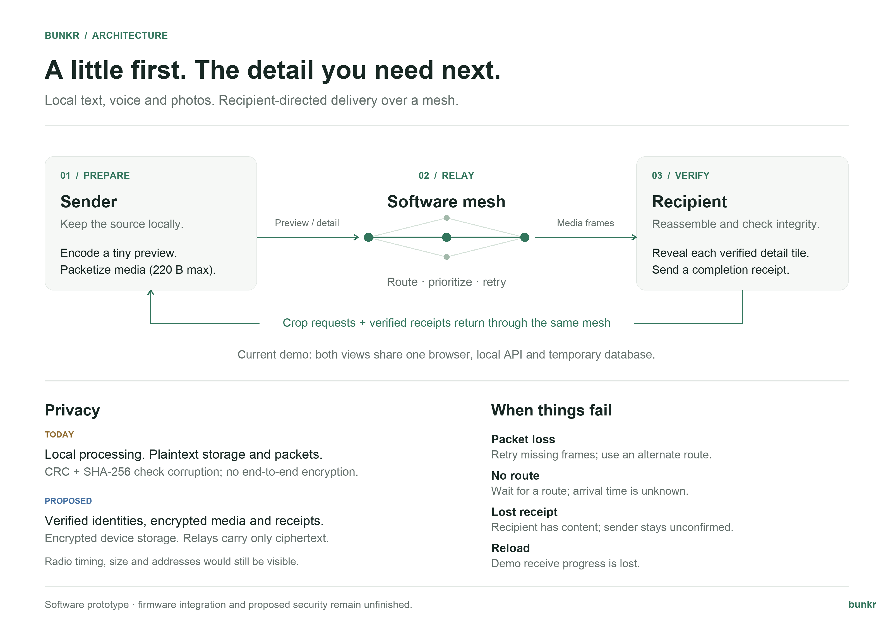

# Project architecture and implementation status

Status reflects the code currently in this repository. **Built** means implemented
and locally tested; it does not imply deployment or physical-radio validation.

## Architecture

### Delivery, trust boundaries and failure modes

[Full-size PNG](assets/architecture.png) · [Editable Mermaid diagram](assets/architecture.mmd)
· Regenerate the PNG with `python scripts/render_architecture.py` (requires Pillow).
The PNG renderer and Mermaid are two maintained views of the same architecture;
editing Mermaid alone does not regenerate the PNG.

Read the flow left to right. Text, voice and images share the binary
packet/verification pipeline. A photo first delivers a tiny preview. A crop
request returns **through the same mesh** before the sender generates six
independently encoded detail tiles. Verified completion ACKs also return through
the mesh; only their arrival and validation let the sender confirm receipt.
See [TEXT_VOICE.md](TEXT_VOICE.md) for the text/voice contract.

The diagram summarizes the implemented delivery flow, current privacy limits,
proposed protections and key failure behavior. The detailed requirements follow.
**The current demo does not implement end-to-end encryption (E2EE), encrypted
storage, or cryptographic peer authentication.** CRC32 and SHA-256 provide
corruption checks against the supplied manifest, not protection against an
attacker who can replace the manifest, payload and ACK.

### Current trust and privacy boundaries

This is a shared local prototype, not two isolated phones. The Python server
returns the encoded manifest and all data frames to one browser before the
software mesh simulates their delivery. Both phone views and the network
inspector share that session. The UI gates display on simulated delivery and
verification, but this is **not a confidentiality boundary**. The source image
endpoint is available to that shared session without recipient authorization.

| Surface | What exists now | Privacy implication / remaining control |
| --- | --- | --- |
| Media processing | Local Python image and text codecs; local FFmpeg Opus encoding; browser decoding. No cloud service is part of the media path. | Sending fewer pixels reduces transmitted content, but a preview, voice note or selected crop may still contain sensitive information. |
| Browser ↔ API | Plain HTTP bound to `127.0.0.1`; no API authentication or explicit Origin/Host authorization checks. `Cache-Control: no-store` is sent. | Loopback limits direct remote access; it does not isolate users, views, or local software. No TLS or endpoint authorization is implemented. |
| Browser memory | Original upload/recording, packet bytes, reconstructed media, object URLs and transfer progress. | Page reload loses receive progress. The shared inspector can see application bytes and the simulated network; it is not a recipient-only view. |
| Local database | Plain SQLite stores retained source pixels, encodings, manifests, chunks/completions, outgoing messages and receipt state. | No application-level at-rest encryption. The UI database uses a temporary directory removed on normal shutdown; deletion is not secure erasure, and abrupt termination may leave artifacts. |
| Photo metadata | Import applies EXIF orientation, converts to RGB and writes a fresh PNG; outbound JPEG/WebP representations are re-encoded without copying EXIF. | GPS/EXIF is not deliberately forwarded by these paths. This is not a comprehensive anonymization guarantee: scene content, signs, faces and other pixel information remain. |
| Application frames | CRC32 per frame, SHA-256 per representation, explicit IDs, bounds, endpoints and chunk indices. | Payloads and metadata are plaintext. Hashes and IDs do not prove sender identity; content-derived image IDs may permit correlation of identical retained pixel data. |
| Meshtastic adapter | Optional official protobuf wrapping, radio-envelope checks and an SDK send/receive bridge tested offline. | Reserving encryption bytes or setting the SDK PKI option does not encrypt the software demo. Connected-device keys, settings and actual protection are not validated here. |
| Logs / retention | The standard HTTP handler logs requests; the simulator emits events. No privacy retention policy is implemented. | URLs can include image IDs. Define log redaction, retention, export, backup and deletion rules before deployment. |

Evidence: [local API and temporary database](../bunkr/ui_server.py),
[retained images and storage](../bunkr/media.py),
[text/voice processing](../bunkr/messages.py),
[browser runtime](../chatterbot/src/mesh/runtime.mjs),
[frame definitions](../bunkr/contract.py), and
[SDK boundary](../bunkr/meshtastic_transport.py).

### Proposed private endpoint architecture — not implemented

The proposed privacy controls are design requirements, not a claim of current protection.
Independent sender and recipient devices should own their databases, source
media, receive state and keys. Relays should forward ciphertext; the recipient
should authenticate and decrypt before trusting manifests, media or control
messages. The SDK bridge exists; connecting it to firmware and independent
persistent endpoints remains unfinished.

1. **Identity and keys:** use a reviewed cryptographic protocol/library, verified
   peer identities and OS-protected key storage. Define pairing, identity change
   warnings, rotation, revocation, device loss and recovery. A node number alone
   is not a verified identity. Shared-channel membership alone is not evidence
   of exclusive sender-to-recipient confidentiality.
2. **Authenticated encryption:** protect media **and** manifests, crop requests,
   missing-chunk reports and completion ACKs. Bind endpoint identities, protocol
   version, transfer/request IDs and chunk position to the authenticated context.
   Ensure nonce uniqueness across retries and restarts; persist replay protection.
   Reject unauthenticated requests before generating crops or changing state.
3. **Packet budget:** account for nonce, tag and identity/session metadata before
   fragmentation, and remeasure the actual upstream envelope. The existing
   220-byte frame cap and 174-byte payload budget cannot simply absorb an added
   application encryption layer without a revised contract or budget.
4. **Durability and local privacy:** encrypt endpoint storage and protect keys
   separately; persist receive chunks, outgoing queues, replay state and receipt
   state atomically. Define expiry, storage quotas, deletion and backup behavior.
   Keep source access restricted to its owner and separate inspector privileges
   from ordinary messaging sessions. Define a protected host-to-radio connection
   as well as the radio ciphertext boundary.
5. **Residual visibility:** encryption cannot hide radio addressing, timing,
   approximate sizes, activity or relay observations by itself. Endpoint compromise
   exposes plaintext while in use; recipients can retain or copy decrypted media.
   Local processing does not imply anonymity or secure deletion.

Before claiming this design is private, test tampering, forged ACKs/requests,
wrong-peer keys, replay across restarts, nonce reuse prevention, revocation,
unauthorized source access, plaintext storage/log leakage and the final encrypted
packet envelope against the actual transport. Those security controls and their
acceptance tests are outstanding.

### Failure modes and recovery

| Failure | Current behavior / evidence | Remaining boundary |
| --- | --- | --- |
| Dropped packet or missing manifest | Per-hop retries and bounded application recovery; missing-frame requests cross the reverse mesh. | Defaults in `MediaNetwork`: five retry limit and three application recovery rounds. Exhaustion fails explicitly; it does not imply delivery. |
| Relay goes offline / route changes | Range-aware routing can use an available alternate path; in-memory progress is retained during a running session. | A partition waits with unknown ETA. No durable expiry policy is implemented; a wait can persist until route restoration or cancellation/reset. |
| Duplicate / out-of-order chunk | ID/index/count/length checks and deduplication; reconstruction orders chunks. Conflicting duplicate bytes are rejected. | Duplicate handling is not cryptographic replay protection. |
| Corrupt bytes or invalid media | CRC, size, content hash and decoding checks prevent successful verification/ACK. Python image recovery discards accumulated chunks after final verification failure. | Browser verification errors surface as transfer failure; automatic durable restart is not integrated. |
| Final ACK lost | Recipient may already display verified content. ACK travels through the same mesh and recovery path; sender stays unconfirmed until a matching ACK arrives. | A native hop/routing ACK never proves media completion. No authenticated ACKs exist yet. |
| Reload, reset or server shutdown | Reset cancels old work; browser receive state is volatile. Normal UI server shutdown removes its temporary database. | Python stores support recovery with a retained database; durable browser/endpoint recovery is not wired into this demo. |
| Bad or oversized upload / codec failure | Photo format, byte, pixel and animation checks reject unsupported inputs. Text/voice limits and FFmpeg timeout bound media handling. | Upload limits do not provide queue fairness, storage quotas or protection from all malicious inputs. |
| API/storage failure | API errors or failed requests prevent completion; codecs cannot fabricate successful content. | No complete storage-full/crash recovery, transaction orchestration or operational alert policy is integrated. |
| Congestion / sustained traffic | Packet priorities and bounded recovery exist in the model. | Fairness, backpressure, expiry, contention, duty-cycle modeling and erasure correction remain unfinished. |
| Forged sender, crop request or ACK | Structural checks reject malformed frames; valid attacker-generated frames are not cryptographically authenticated. | Proposed peer authentication, E2EE, authorization and replay checks are required. |

**Delivery invariants:** preview receipt is not full-image receipt; a tile is shown
only after its own verification; recipient verification is distinct from sender
confirmation; a disconnection has no reliable arrival countdown.

Existing automated evidence is in [media tests](../tests/test_media.py),
[message tests](../tests/test_messages.py),
[API tests](../tests/test_ui_server.py),
[photo import tests](../tests/test_photo_import.py),
[network tests](../tests/ui/network.test.mjs),
[protocol tests](../tests/ui/protocol.test.mjs),
[runtime tests](../tests/ui/chatter-runtime.test.mjs) and
[SDK tests](../tests/test_meshtastic.py). These validate local behavior, not
firmware operation, RF performance or the proposed cryptographic design.

### Other demo boundaries to replace

| Current demo boundary | Actual replacement | Existing code retained |
| --- | --- | --- |
| Both phone UIs share one browser and local API | Separate sender and receiver endpoints; transport delivers requests and ACKs | Chat/crop interaction, media engine, wire contract and verification |
| Browser receive state is in memory; server database is temporary | Durable storage per endpoint, with restart recovery connected to the transport | Existing SQLite media storage and recovery logic |
| Shared software radio model | Firmware-backed transport events and richer channel modeling | Map, media contract, verification and controls |

The demo wraps frames using official protobufs when the optional Meshtastic
SDK dependency is installed. It does **not** currently send them through the
SDK Bridge or firmware. The bridge and SQLite recovery code already exist;
end-to-end integration is the missing work.

Meshtasticator is the next software transport target. Physical LoRa accessories
connected over BLE/serial are a later option, outside the initial scope.

## What is finished, partial, and outstanding

| Area | Status | What we have / what remains |
| --- | --- | --- |
| Phase 1: media handling | **Built** | Original retention, EXIF orientation, JPEG/WebP encoding, preview/crop/full-image representations, binary packets, integrity checks, cache reuse and restart-safe Python reconstruction. |
| Text and voice | **Built over integrated software mesh** | Bidirectional UTF-8/zlib text and mono Opus voice, the reference recording composer, playback after verification, and matching receipt ACKs. Video remains unimplemented. |
| Two-phone interaction | **Built as a local UI** | Send a preview, draw selections, request each area or render the whole image, progressively reveal six independently verified source tiles, and confirm receipt after the ACK returns. |
| Network visualization | **Integrated** | Five range-aware nodes, seeded per-hop loss, bounded hop/application recovery, priority queue, radio presets, alternate routes, pause and disconnection. Byte and time metrics come from the engine. |
| Meshtastic reuse | **Adapter built; integration pending** | Official SDK/protobufs and a send/receive bridge are tested offline. Connected endpoints, firmware nodes and transport dispatch are not wired together. |
| Phase 2: transport and radio model | **Partial** | Range, presets, approximate airtime, packet-boundary priority and bounded recovery are built. Firmware integration, fairness, backpressure, expiry, contention, duty-cycle behavior and erasure correction remain unfinished. |
| Phase 3: production application | **Partial** | The interaction is implemented in the local software demo. Photo import (JPG/PNG/WebP/HEIC) is built. Separate device sessions and durable browser receive state remain unfinished. Full-image requests use the same verified tile pipeline. |
| Performance and acceptance evidence | **Partial** | Codec/packet measurements and automated local checks exist. Firmware-backed acceptance, physical airtime validation, request round-trip benchmarks and crop-versus-full-image benchmarks remain outstanding. |
| Physical radios / native mobile apps | **Outside initial scope** | No physical LoRa/BLE field validation or native iOS/Android app has been built. |

## How a section becomes sharp today

1. The sender retains the original; the server encodes a tiny preview.
2. Actual preview packets cross the shared software mesh. The browser reconstructs
   and verifies them before displaying the preview.
3. The recipient draws a box and taps its **render arrow**. The request crosses
   the reverse mesh route before the server creates detail.
4. The server crops the original into six independently encoded tiles. Their
   actual packets cross the software mesh, and each verified tile appears in place.
5. Completion ACKs travel back. The sender shows confirmed receipt only after
   the server receives and validates those ACKs.

The server's demo database is temporary and removed on shutdown. Python media
storage supports restart recovery with a retained database, but browser receive
progress currently lives in memory and does not survive a page reload.

## Code map

| Component | Implementation |
| --- | --- |
| Phone UI and interaction | [App.tsx](../chatterbot/src/App.tsx), [components](../chatterbot/src/components), [runtime.mjs](../chatterbot/src/mesh/runtime.mjs) |
| Shared mesh and native contract adapter | [simulator.mjs](../bunkr/ui/mesh/simulator.mjs), [network.mjs](../bunkr/ui/network.mjs) |
| Browser packet receiver | [protocol.mjs](../bunkr/ui/protocol.mjs) |
| Local API | [ui_server.py](../bunkr/ui_server.py) |
| Image processing and SQLite state | [media.py](../bunkr/media.py) |
| Text/voice media and persistence | [messages.py](../bunkr/messages.py), [runtime.mjs](../chatterbot/src/mesh/runtime.mjs) |
| Binary frame contract | [contract.py](../bunkr/contract.py) |
| Official SDK adapter | [meshtastic_transport.py](../bunkr/meshtastic_transport.py) |
| Local event vocabulary | [events.py](../bunkr/events.py) — full transport metrics integration remains pending |
| Automated checks | [Python tests](../tests), [browser module tests](../tests/ui), [CI configuration](../.github/workflows/media.yml) |

See [implementation phases](../IMPLEMENTATION_PHASES.md),
[UI behavior and limits](UI_MOCK.md), and
[Meshtastic integration boundary](MESHTASTIC.md) for the detailed contracts.

### Integrated network workspace

The middle panel uses the updated chatterbot floating glass mesh card and its
hover reveal, live packet animations, range rings, animated settings switcher and
event timeline. Node position/range/online, radio/loss and seeded reset operate on
the existing simulator. Both phones use the reference components directly.
The legacy mesh inspector/stepping modules remain separately tested, but their
extra controls are not added to this reference interface. Estimates are approximate
and are not calibrated to firmware or physical radios.
